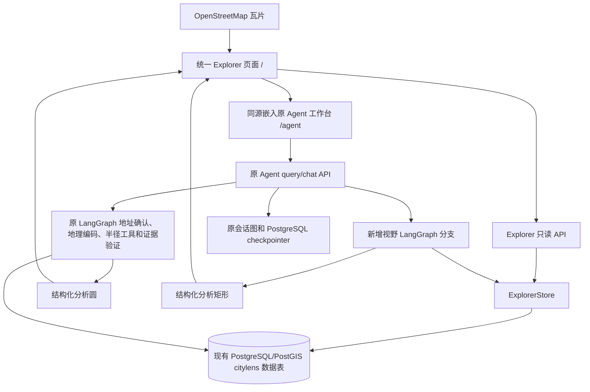

# Explorer 与 CityLens Agent 集成报告

日期：2026-11-15（America/Los_Angeles）

## 1. 实现结果与验证边界

Explorer 和原 LangGraph Agent 已接入同一个 FastAPI 应用，使用现有 PostgreSQL/PostGIS 作为运行时数据源。统一页面为 `http://127.0.0.1:8000/`，原 Agent 工作台仍可通过 `/agent` 打开。地图请求不再读取或构建 SQLite 缓存。

本机 `.env` 配置存在，但实施期间 Docker Linux 引擎不可连接，已有 PostgreSQL 连接超时。因此，没有将历史 CSV 的 31,667 条记录当成当前数据库的实测数量，也没有执行开发库迁移、导入或数据修改。真实数据差异、真实 PostGIS 执行和在线模型效果仍需在服务可用后核验。

## 2. 系统架构



原工作台以同源 iframe 嵌入，保留地址确认、候选地址选择、证据、工具日志、SQL 重放、会话创建/恢复/删除和 JSON 下载。工作台与地图通过 `postMessage` 传递结构化上下文及分析范围，同时校验 `event.origin` 和 `event.source`。没有从回答文字反向解析坐标。

`backend.explorer_app:app` 改为统一应用的兼容导入，不维护另一套服务器实现。Windows 启动继续使用已有 `backend.scripts.serve`，保证 psycopg 异步连接使用 SelectorEventLoop。

## 3. 数据迁移与字段映射

### 3.1 迁移决策

本次没有新增或重建业务数据表，没有运行 DDL、导入、地理编码或历史数据更新。所有数据来自现有 `citylens.service_requests`、`citylens.traffic_collisions` 和对应 import 表。缺失的展示字段从已有 JSONB `raw_record` 投影，不建立平行数据管线。

旧 `explorer_data.py` 保留作为历史 CSV 审计辅助及旧缓存回归参考，不在应用启动或 API 请求路径中调用。现有 `.local/explorer.sqlite3` 即使保留，也不用于运行时统计，不存在 SQLite 自动降级。

### 3.2 Get It Done 字段映射

| CSV / Explorer 字段 | PostgreSQL 来源 | 处理与含义 |
| --- | --- | --- |
| `service_request_id` / `id` | `service_request_id` | 每个请求 ID 一条当前记录 |
| `date_requested` / `requested` | `requested_at AT TIME ZONE 'America/Los_Angeles'` | 以洛杉矶本地时间展示 |
| `service_name` / `category` | `service_name` | 清理空格，空字符串转 NULL |
| `status` | `status` | 原始状态；Closed 不等于已修复 |
| `council_district` | `raw_record->>'council_district'` | 服务请求地图要求精确值 `1` |
| `comm_plan_name` / `community` | `raw_record->>'comm_plan_name'` | 来源标签，非经过验证的规划区多边形 |
| `zipcode` | `raw_record->>'zipcode'` | 来源 ZIP，不进行空间反推 |
| `lat` / `lng` | `ST_Y(location::geometry)` / `ST_X(location::geometry)` | 使用库中已存坐标 |
| `street_address` / `address` | `raw_record->>'street_address'` | 原始地址展示字段 |
| `date_closed` / `closed` | `raw_record->>'date_closed'` | 来源字符串，可能缺失 |
| `service_request_parent_id` / `parent_id` | `parent_id` | 来源提供的关联关系 |
| 来源元数据 | `citylens.ingestions` | import ID、文件、SHA-256、本地导入时间 |

缺少 district 的记录不能可靠归入 District 1，因此不进入该地图范围。规划区或 ZIP 缺失时保留 NULL，API 用 `__missing__` 查询这些值。详情只返回允许的展示字段，不返回整份 `raw_record` 或公众自由文本描述。

### 3.3 数据范围与重复处理

服务请求地图保留 **2026 年、来源 District 1** 的范围。日期包含首尾两天，SQL 将其转换为洛杉矶时区的 `[start 当日零点, end 次日零点)`，使用原时间索引查询。

原 Agent 半径查询沿用原范围和参数契约，不自动附加 District 1 或 2026 限制。因此地图总量与某个 Agent 半径结果可能不同，页面明确区分两者。

PostgreSQL 是按 ID upsert 的当前记录集合，不是历史 CSV 精确快照。旧文件中消失的 ID 可能仍在数据库中，后续导入也可能改变字段。`exclude_linked=true` 只排除有 parent ID 的提交，不能识别所有现实重复问题。

`/metadata` 返回当前统计、全表覆盖诊断、最多最近 100 个 imports 及截断标记、历史 CSV 参考数量和当前数量差异。数量相同不代表记录内容一致。

### 3.4 交通碰撞图层

复用 `citylens.traffic_collisions`：`report_id → id`，`occurred_at → requested`，`normalized_address → address`，`location → lat/lng`，`geocode_status → status`。类别展示为 `Traffic collision`。规划区、ZIP、关闭时间和 parent ID 没有对应字段，返回 NULL。

界面禁用不适用的筛选，碰撞 KPI 展示有坐标记录数量。碰撞图层范围是 **导入数据中的 2026 年记录**，没有假定其属于 District 1；状态表示地理编码状态，不表示案件是否解决；坐标仍为来源标注的近似位置。缺坐标记录保留在全局统计中，但无法进入地图视野。

## 4. 只读查询与地图聚合

`ExplorerStore` 复用原 Agent 的 `ensure_reader()`，拒绝管理员、所有者或拥有业务写入权限的账号。每次操作建立 `REPEATABLE READ READ ONLY` 事务，连接超时 3 秒、语句超时 10 秒、锁等待 2 秒。

表名、字段和表达式由代码白名单选择；日期、标签、边界、ID 和分页参数全部绑定。数据库错误返回脱敏诊断，连接失败不会变成统计 0。

普通区域查询组合以下条件：

```sql
location && ST_MakeEnvelope(%s, %s, %s, %s, 4326)::geography
AND ST_Intersects(location::geometry, ST_MakeEnvelope(%s, %s, %s, %s, 4326))
```

第一项复用已有 geography GiST 索引筛选候选，第二项进行包含边界的精确矩形判断。对跨度达到 180 度或包含极点的宽视图，跳过不适合的 geography envelope 预筛选，保留几何矩形判断。跨日期变更线、反向、零面积、超范围和非有限边界被拒绝。

保留原显示阈值：

- 视野内最多 700 条：返回全部匹配点，每点对应一个报告。
- 超过 700 条：按自适应经纬度网格分组，返回数量和平均坐标作为气泡位置。
- 网格宽度为 `max(360 / 2**zoom * 0.12, 经度跨度 / 30, 纬度跨度 / 30)`。
- 分组覆盖全部符合条件的有坐标记录，不截断为前 700 条。

页面分别展示全局筛选总量、视野内总量、实际返回的 marker/bubble 数量。拖动地图只刷新视野图层，全局图表和分页列表不受地图边界隐式限制。Agent 的蓝色分析覆盖层独立于原报告图层；两者的数据集、日期或筛选条件可能不同，页面会明确说明。

## 5. Agent 空间查询与可视化

### 5.1 半径分析

原 `query`、地址确认、候选选择、Census/SanGIS、只读工具、计算、证据校验和会话流程继续使用，默认半径仍为 800 米。

新增 `QueryResponse.visualization`，从完成验证的 `EvidenceRecord.scope` 构建位置 ID、坐标、半径、数据集及 evidence ID。失败或不可用的证据不生成分析圆。原 SQL 函数、指标和比较计算未改变。

### 5.2 显式视野分析

`ChatTurn` 新增可选 `viewport_context`，包含 `bounds` 和筛选条件。前端提交对话时获取当前地图范围及**已经应用**的筛选，不采用尚未应用的表单编辑。上下文存在本身不会启用视野分析：只有“current map view”“shown on the map”“当前地图”等明确请求才进入新增分支。

新增 LangGraph 分支执行：受限计划 → Pydantic 校验 → 验证修改条件有用户原文依据 → PostgreSQL 确定性统计 → 校验类别、状态和月度之和均等于总量 → 模板化回答及结构化矩形元数据。

模型只能选择 viewport/radius/clarify、数据集和有限筛选字段，没有坐标、SQL 或统计结果输出字段。类别、状态、规划区和 ZIP 必须有原文依据，并在数据库中解析为唯一来源标签；不存在或有歧义时要求澄清。“unresolved”不会被擅自等同于某个源状态。

同时明确要求矩形和半径时要求澄清；新地址或半径问题离开已保存的视野模式；待确认地址不会被地图请求静默丢弃。

视野结果通过独立的 `ChatResponse.viewport_analysis` 返回：指标、数值、准确范围、实际筛选、类别/状态/月度统计、事务快照、本地导入时间、可独立核对的参数化计数 SQL 及局限性。`ChatResponse.visualization` 的矩形取自同一范围。没有把视野证据伪装成原半径 `EvidenceRecord`，也没有绕过原半径证据验证。

### 5.3 会话行为

原 `ConversationRunner` 保存 `mode=viewport` 的结构化上下文，通过原 checkpointer 持久化。后续分析重新查询数据库，不复用旧数值。移动地图不会改变已保存视野；只有用户再次明确要求当前地图时才采用新边界。原半径会话格式保持兼容。

初始澄清会保留地图范围，用户可以继续补充来源标签。未配置会话数据库时，使用原进程内会话，重启后不保证恢复。

## 6. 统一 API

| 路径 | 作用 |
| --- | --- |
| `GET /` | Explorer 和嵌入的 Agent |
| `GET /agent` | 原 Agent 完整工作台 |
| `GET /assets/...` | 原静态资源及本地 Leaflet |
| `GET /docs` | 统一 OpenAPI 文档 |
| `GET /api/v1/explorer/metadata` | 当前覆盖、来源、筛选项和历史参考差异 |
| `GET /api/v1/explorer/summary` | 全局筛选后的 KPI、类别、状态、月度统计 |
| `GET /api/v1/explorer/map` | 当前矩形中的点或气泡 |
| `GET /api/v1/explorer/requests` | `limit`/`offset` 分页记录 |
| `GET /api/v1/explorer/requests/{id}` | 选择的数据集中的单条详情 |
| `POST /api/v1/agent/chat` | 原地址对话，新增可选视野上下文和响应 |
| `POST /api/v1/agent/query` | 原坐标/半径分析，新增可视化字段 |
| `GET/POST/DELETE /api/v1/sessions...` | 原会话创建、列表、恢复和删除 |
| `GET /api/v1/status` | 原配置存在性检查，不承诺连通性 |
| `POST /api/v1/tools/run` | 原允许列表工具执行和证据重放 |
| `GET /api/v1/tools/service-categories` | 原服务类别发现 |

Explorer 原响应的 `records/facets`、`total/months/categories`、`mode/items` 和分页/详情关键字段保留。新增 `dataset` 参数默认为 `service_requests`，也可选择 `traffic_collisions`。Explorer 限定 2026 年范围，分页最多 100 条，地图最多返回 700 个独立点。

## 7. 文件变更

| 文件 | 作用 |
| --- | --- |
| `backend/explorer_models.py`（新增） | 边界、筛选、视野上下文和可视化契约 |
| `backend/explorer_store.py`（新增） | PostgreSQL/PostGIS 只读投影、统计、图层和详情 |
| `backend/explorer_api.py` | 保留路由和主要响应形状，切换 PostgreSQL 数据层 |
| `backend/explorer_app.py` | 统一应用的兼容导入 |
| `backend/main.py` | 注册地图 API，提供统一页面和 `/agent` |
| `backend/agent/map_analysis.py`（新增） | 受限视野 LangGraph、验证和结构化范围 |
| `backend/agent/llm.py` | 复用原 structured-output 适配器规划视野 |
| `backend/agent/models.py`、`location_models.py` | 新增可选上下文和可视化响应字段 |
| `backend/agent/workflow.py` | 接入视野分支和验证后半径可视化 |
| `backend/agent/location_flow.py` | 进程内上下文兼容字段 |
| `backend/agent/sessions.py` | 保存/恢复视野模式，保护待确认地址 |
| `frontend/explorer.html`、`explorer.css`、`explorer.js` | 嵌入工作台、数据集切换、消息桥和独立覆盖层 |
| `frontend/app.js`、`frontend/index.html` | 视野证据展示、同源消息桥和顶层导航 |
| `backend/scripts/audit_explorer.py`（新增） | 逐 ID/字段核对现有 PostgreSQL 与 CSV，仅输出本地报告 |
| `backend/explorer_tests/conftest.py`（新增） | 隔离真实配置和凭据 |
| `backend/explorer_tests/test_unified.py`（新增） | 参数、范围隔离、证据和跨轮会话回归 |
| `backend/explorer_tests/test_postgres_explorer.py`（新增） | 可选隔离 PostGIS 实测和独立 SQL 核对 |
| `backend/explorer_tests/test_browser.py`（新增） | 使用固定数据的实际 Edge 交互验证 |
| `backend/explorer_tests/test_explorer.py` | 保留历史 CSV 投影和 Windows 缓存关闭回归 |
| `backend/agent_tests/test_evaluation_ui.py` | 新旧页面入口回归 |
| `README.md`、`COURSE_EXPLORER.md`、`backend/README.md`、`backend/EVALUATION.md` | 更新入口、数据源和运行说明 |

保留了此前 SQLite 连接关闭修复和已暂存的改动，没有撤销或重新暂存用户工作。没有改动数据库 schema、compose 存储或 Agent SQL 工具。

## 8. 已执行验证

完整回归结果：**516 passed, 57 skipped，21.99 秒**。包含实际 Edge 浏览器测试 1 项；57 项跳过包括本次新增的 3 项 PostGIS 集成测试和既有环境门控测试，跳过不表示通过。

```powershell
.\.venv\Scripts\python.exe -m pip install -r backend\requirements-agent-test.txt
.\.venv\Scripts\python.exe -m pytest backend\explorer_tests backend\agent_tests -q
```

新增测试覆盖参数绑定、时间/边界校验、缺少数据库时的 503、视野仅在明确请求时使用、新半径不继承旧矩形、筛选引用验证、失败不返回 0、可视化与证据一致、移动地图后保留原视野、重建会话图恢复、初始澄清恢复和待确认地址保护。

实际 Microsoft Edge 检查使用固定数据、假模型和假数据层，不调用真实模型或开发数据库。验证了同源 iframe 对话、矩形和 800 米圆形覆盖层、数据集切换、不适用筛选禁用、清除覆盖层、移动端无横向滚动、无页面 JS 异常，以及未应用的筛选不进入地图上下文。最后一次专项浏览器检查：**1 passed，4.68 秒**。

```powershell
.\.venv\Scripts\python.exe -m pip install playwright
.\.venv\Scripts\python.exe -m pytest backend\explorer_tests\test_browser.py -q
```

浏览器测试使用已安装的 Microsoft Edge，拦截在线 OSM 瓦片请求，截图位于忽略的 `.local/unified-desktop.png` 和 `.local/unified-mobile.png`。未安装 Playwright 或 Edge 时，该可选测试跳过。

原前端回归 `startup.test.cjs`、`location-flow.test.cjs`、`sessions.test.cjs` 全部通过。JS 语法检查和 `git diff --check` 通过。脚本通过已安装 Playwright 随附的 Node 执行，没有新增前端构建步骤。

Docker 可用后，可显式运行隔离 PostGIS 测试：

```powershell
$env:AGENT_TEST_DOCKER = '1'
.\.venv\Scripts\python.exe -m pytest backend\explorer_tests\test_postgres_explorer.py backend\agent_tests -q
```

这些测试使用自有临时容器/`*_test` 数据库，结束后删除测试容器，不向开发数据表写入。新增测试检查独立 SQL 总量、筛选、缺坐标、矩形边界、气泡总和、分页、详情、碰撞范围、拒绝管理员凭据和未知标签。目前未执行成功，不能据此宣称真实 SQL 已验证。

## 9. 已有数据只读核验

```powershell
.\.venv\Scripts\python.exe -m backend.scripts.audit_explorer
Get-Content .local\explorer-postgres-audit.json
```

脚本检查 CSV SHA-256、来源行数、去重范围，PostgreSQL 的时间覆盖、状态、坐标和关联记录，district 分布、缺失字段、仅存在于一侧的 ID，以及相同 ID 的字段差异和坐标差异（容差 1e-7 度）。仅写入忽略的本地 JSON，不修改 CSV、数据库或 SQLite。

本次实际输出为 `status=not_verified`、`diagnostic_code=database_connection_failed`。没有据此断言 PostgreSQL 与 CSV 相同，没有生产库独立 SQL 实测数字或性能结论。

## 10. Windows PowerShell 启动

先在 Docker Desktop 中启动**已有 CityLens 数据容器**。当前项目目录可能与原环境不同，不要盲目新建 compose volume 或重复导入数据。本次未创建或替换开发数据库。

```powershell
cd 'E:\Github Projects\SanDiego_CityLens_QHY'

if (-not (Test-Path -LiteralPath '.venv\Scripts\python.exe')) {
    python -m venv .venv
}
.\.venv\Scripts\python.exe -m pip install -r backend\requirements.txt

if (-not (Test-Path -LiteralPath '.env')) {
    Copy-Item .env.example .env
}

# 在本地配置 .env，保留现有值，不提交凭据。
# AGENT_DATABASE_URL：已有数据库的受限 reader，同时用于地图和 Agent。
# OPENAI_API_KEY / OPENAI_MODEL：原 Agent 模型配置。
# SESSION_DATABASE_URL：原独立会话 writer，可选；启用前需已有会话迁移。

docker ps --format '{{.Names}} {{.Image}} {{.Ports}}'
.\.venv\Scripts\python.exe -m backend.scripts.audit_explorer
.\.venv\Scripts\python.exe -m backend.scripts.serve --host 127.0.0.1 --port 8000
```

浏览器访问 `http://127.0.0.1:8000/`；原工作台在 `/agent`，API 文档在 `/docs`。保持终端运行，Ctrl+C 停止；修改 `.env` 后重启。根 `.env` 按原逻辑优先于进程环境变量。

若已配置的会话数据库不可连接或尚未迁移，原应用的启动检查可能失败，应先修复该连接/迁移。已有 reader/session 初始化步骤见 [AGENT.md](backend/AGENT.md) 和 [P1_3.md](backend/P1_3.md)，不是地图集成要求的新业务 DDL。

## 11. 已知限制与后续核验

- 生产库逐字段对比、真实 PostGIS 测试及查询计划/性能尚未核验，启动 Docker 后需执行第 8、9 节。
- 未进行真实 OpenAI 调用或在线地理编码，假模型测试不证明实际自然语言准确率。
- 视野跨轮恢复已使用内存 checkpointer 测试，实际 PostgreSQL checkpoint 持久化仍需服务可用后验证。
- 视野分支支持单数据集、2026 年矩形范围内的计数及类别/状态/月度汇总。视野间比较、复杂伤亡条件、任意多边形和任意 SQL 不在该分支中；需澄清或使用原半径工具。
- 模糊公寓品牌或地点名称可能需要补充明确地址，没有新增猜测坐标的路径。
- 规划区或 ZIP 缺失时显示未知，没有用反向地理编码填充。
- 分析范围和气泡不代表完整社区边界、风险、维修结果或独立物理问题数量。
- OSM 底图需要联网，浏览器测试未验证在线瓦片可用性。
- iframe 保留独立滚动区域，完整工具可通过“Open full workspace”打开。
- 未提交、合并或推送任何变更。
