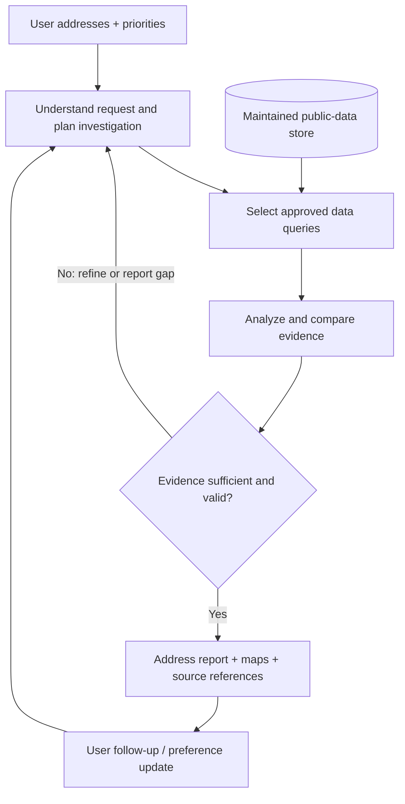

# CityLens

### Know Before You Move. Stay Informed After.

**An agentic neighborhood intelligence platform for evidence-based rental decisions.**

> **Project status: Design / pre-implementation.** This repository currently describes the intended product, public data sources, and evaluation plan. Features below are **planned**, not claims of a working deployment. Implementation progress will be tracked in the roadmap.

## Overview

Choosing where to live involves more than rent and apartment photos. Prospective renters often have to jump between transit maps, local government portals, development records, and neighborhood information to understand what living at a particular address might actually be like.

**CityLens** aims to turn that fragmented research into a single, personalized investigation. Users provide **candidate addresses** and their priorities; CityLens investigates a **pre-collected, maintained collection of public datasets**, compares the addresses, and returns a source-linked neighborhood report.

**Users do not need to upload CSVs or supply their own datasets.** This is a location-aware consumer product, not a general-purpose data analysis chatbot.

### Who is it for?

- **Prospective renters and people relocating:** Compare housing options beyond listing price and apartment amenities.
- **Students and car-free residents:** Prioritize transit access, commutes, walkable amenities, and practical day-to-day needs.
- **Current residents (future scope):** Follow relevant neighborhood changes and understand how to report local infrastructure issues.

**Initial geographic scope:** San Diego, California.

## The Problem

A renter considering two apartments might ask:

> "I'm moving to San Diego for graduate school. I don't own a car. Which apartment is more convenient for commuting, buying groceries, and everyday life? Are there any recurring infrastructure complaints or nearby development projects I should know about?"

A search engine returns links. A map shows places. A fixed dashboard shows preselected statistics. None necessarily connects the user's priorities, multiple addresses, historical public records, and the limitations of those records into a coherent, verifiable comparison.

CityLens is designed to help answer **which option fits this user, what evidence supports that conclusion, and what remains uncertain**.

## Planned Product Experience

### 1. Investigate an address

The user enters a San Diego address and selects relevant priorities such as:

- Public transit and commute to a chosen destination
- Grocery stores and other everyday amenities
- Publicly reported streetlight, pothole, trash, or other infrastructure issues
- Historical traffic collision records near relevant roads
- Nearby development approvals worth checking

The result is an **address-specific neighborhood report**, not a generic neighborhood rating.

### 2. Compare candidate homes

The user submits two or more candidate addresses and describes their trade-offs in natural language:

> "Compare these two apartments for someone without a car who commutes to UCSD. Transit matters most, then grocery access. Flag local issues I should verify in person."

CityLens is intended to:

1. Translate the user's preferences into investigable questions.
2. Retrieve relevant evidence from prepared datasets.
3. Compare options using explicit, user-adjustable priorities.
4. Identify uncertainty, missing coverage, and issues requiring verification.
5. Produce a structured recommendation with maps, comparisons, and source references.

No universal "best neighborhood" or opaque safety score is assumed.

### 3. Continue asking follow-up questions

Examples:

- "What if I prioritize public transit over nearby shopping?"
- "Are the streetlight complaints near Option B recent or several years old?"
- "Does that development record mean construction is happening right now?"
- "Which findings come from official records, and which are estimates?"

The agent should preserve the relevant address and preference context without inventing missing data.

### Future extensions (not part of the initial MVP)

- **Neighborhood Watch:** Track new public records relevant to a saved area.
- **Issue Resolution Assistant:** Help residents find the appropriate official reporting channel and follow the public status of an existing case.

## Why an AI Agent?

The central challenge is not generating a single paragraph about a neighborhood. It is **planning and executing a multi-step, evidence-backed investigation** whose steps depend on the user's question and the data found along the way.

For instance, if a user asks whether a location has persistent pothole issues, a useful investigation may:

1. Find nearby Get It Done pothole reports over an appropriate time window.
2. Distinguish original cases from linked duplicate submissions.
3. Compare patterns across time periods and nearby areas, with appropriate caveats.
4. Inspect relevant report statuses and their timestamps.
5. Decide whether the available evidence is sufficient, then report findings and limitations.

The **planned agent workflow** is:

**Key design principle:** Agency should come from adaptive investigative decisions, not from unnecessarily creating many conversational agents. A single orchestrator with specialized, auditable tools may be preferable to a complex multi-agent setup.

## Public Data Sources

The platform will curate and refresh its **own** datasets. The following sources have official public entry points; their integration into CityLens is still planned.

| Source | Potential use | Important caveat |
| --- | --- | --- |
| [San Diego Get It Done reports](https://data.sandiego.gov/datasets/get-it-done-reports/) | Historical citizen-submitted infrastructure issues and report statuses | A report is not proof that a problem currently exists; `Closed` does **not** imply a completed repair. Linked duplicates and reporting bias matter. |
| [SDPD traffic collision reports](https://data.sandiego.gov/datasets/traffic-collisions/) | Historical police-recorded collision locations and trends | Not a complete census of all collisions; many property-damage-only events and freeway incidents are outside this source. |
| [Development approvals](https://data.sandiego.gov/datasets/development-permits/) | Permits and other development-related approvals near a candidate address | Approval or permit status does **not** by itself mean construction is currently occurring. |
| [San Diego MTS developer data](https://www.sdmts.com/business-center/app-developers) | GTFS route, stop, and scheduled-service information | Static schedules are **not** live vehicle locations or guaranteed trip times. |
| [OpenStreetMap](https://www.openstreetmap.org/copyright) (potential source) | Nearby grocery stores, parks, and other mapped amenities | Map completeness varies; usage must respect attribution and licensing requirements. |

The initial release should prioritize data whose coverage, update process, and geographic relevance have been validated. Additional public sources should be added only if they improve a real user decision.

### Evidence and freshness

Every data-backed statement should include, where feasible:

- The source dataset and direct reference or record identifier
- The geographic area and search radius used
- The time window of the query
- The timestamp of the latest successful dataset refresh
- Important methodological limitations and missing data

This is essential because **data availability and record dates are not the same as actual on-the-ground conditions**.

## Proposed System Boundaries

This repository is intended to separate two responsibilities:

**Offline / scheduled data preparation**

- Download or retrieve authorized public datasets.
- Normalize source schemas and geographic references.
- Deduplicate records where the source provides explicit duplicate relationships.
- Track source provenance, freshness, and ingestion errors.
- Precompute selected geographic and temporal aggregates where useful.

**On-demand user investigations**

- Resolve user-provided addresses and preferences.
- Plan a bounded sequence of approved data lookups and analytical operations.
- Validate tool outputs and calculations before making claims.
- Construct address comparisons using evidence, not unsupported assumptions.
- Present maps, findings, uncertainty, and reproducible source references.

The agent should use **read-only, bounded tools** against the prepared data rather than executing unrestricted code or arbitrary SQL. The exact implementation stack is not finalized.

## MVP Scope

The first usable version is intentionally narrow:

1. **San Diego only**, with user-supplied candidate addresses (not uploaded datasets).
2. **Single-address investigation** plus **two-address comparison**.
3. An initial set of validated public data domains: service requests, collisions, transit schedules, and development approvals; amenity coverage will be added after data-source validation.
4. Natural-language priorities, a structured investigation plan, and source-linked findings.
5. Honest uncertainty: no invented commute ETAs, live conditions, repair completion dates, or explanations of causality.

### Out of scope for MVP

- Apartment listing aggregation, booking, or lease transactions
- Guaranteed rental prices or unit availability
- Crime/safety rankings or demographic-based neighborhood scoring
- Real-time transit arrival guarantees
- Automatic submission of city complaints
- Claims that public report counts measure the true number of physical problems

## Evaluation Plan

A useful agent must be more than visually convincing. Evaluation will use a curated set of address-investigation tasks with known source evidence and, when applicable, reference calculations.

| Dimension | What to measure |
| --- | --- |
| **Task completion** | Did the system answer every relevant part of the user's request? |
| **Evidence grounding** | Can each factual claim be traced to a source record, query result, or documented calculation? |
| **Analytical correctness** | Are counts, rates, comparisons, deduplication, and date filters valid? |
| **Tool reliability** | Are invalid queries detected and recovered from within bounded retries? |
| **Preference alignment** | Do comparisons respond predictably to changes in user priorities? |
| **Efficiency** | Latency, number of tool calls, and LLM usage per investigation |
| **Uncertainty calibration** | Does the system abstain when the underlying data cannot support a conclusion? |

**Proposed baselines:** (1) fixed rule-based dashboard/report and (2) a one-pass LLM summary over retrieved context. No benchmark scores are available yet.

## Roadmap

- [ ] **Milestone 1 — Data audit:** Verify source coverage, schema, update cadence, licensing, and geographic joins.
- [ ] **Milestone 2 — Evidence layer:** Build repeatable, testable address-based and time-windowed queries.
- [ ] **Milestone 3 — First agent:** Support bounded tool selection, multi-step investigations, and source citations.
- [ ] **Milestone 4 — User-facing MVP:** Ship single-address reports and two-address comparisons.
- [ ] **Milestone 5 — Reliability:** Add groundedness checks, adversarial cases, error recovery, and benchmarks.
- [ ] **Milestone 6 — Deployment:** Publish a demo, screenshots, setup instructions, and measured evaluation results.
- [ ] **Milestone 7 — Extensions:** Explore saved-neighborhood monitoring and reporting assistance.

## Responsible Use and Limitations

CityLens is a **decision-support tool**, not an authoritative assessment of housing quality, individual properties, public safety, or legal compliance.

- Do not infer causality from correlations in complaint, collision, or permit records.
- Avoid penalizing neighborhoods simply because residents report issues more frequently.
- Keep original reports distinct from explicitly linked duplicate submissions; document counting rules.
- Avoid ranking areas by demographics, protected characteristics, or proxies for them.
- Explain incomplete geographic coverage, stale data, location imprecision, and missing records.
- Treat a development approval as an administrative record, not proof of active construction.
- Treat public transit timetables as schedules, not real-time guarantees.
- Encourage users to confirm material findings through current official sources and on-site visits before signing a lease.

## Current Repository Status

This README is the **initial product specification**, not a claim that the platform has already been built. Code, screenshots, a live demo, and performance metrics will be added as milestones are completed.

## Data Attribution

City of San Diego open-data records are published by their respective departments. Transit information is provided by San Diego Metropolitan Transit System. If OpenStreetMap data is used, its attribution and licensing requirements will be followed. Data-source terms and download permissions will be checked before redistribution.

---

**CityLens — Know Before You Move. Stay Informed After.**
